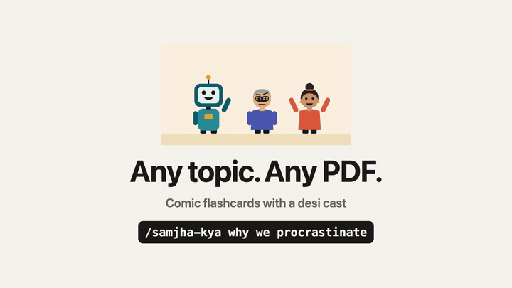

# samjha-kya

**Any topic or PDF, as a desi comic flashcard deck.** An Agent Skill for Claude Code, Codex, Cursor and other coding agents.

<p align="center"></p>

```bash
npx skills add amishah1998/samjha-kya
```

Then ask your agent: `/samjha-kya why we procrastinate`, or `turn ./guide.pdf into a samjha-kya deck`. You get one HTML file that works on phones and laptops.

Most cards are a short conversation between three characters, next to a cartoon panel that labels the card's key idea:

- **Chintu**, the robot who read the entire internet, explains.
- **Sharma ji**, the sceptic, says "Data dikhao" and catches the mistakes.
- **Pinky**, the eager learner, asks what you were thinking and tries every shortcut first.

The stories happen at the chai tapri, in the local train and in the family WhatsApp group, with the odd Bollywood line where it helps the idea land.

## See it

Open these on your phone. Swipe up for the next card.

| Deck | Made from | Size |
|---|---|---|
| [Kal se pakka: why we procrastinate](https://amishah1998.github.io/samjha-kya/procrastination.html) | a topic | 3 chapters, 68 cards |
| [Paisa kaise badhta hai: compound interest](https://amishah1998.github.io/samjha-kya/money.html) | a topic | 3 chapters, 72 cards |
| [Neend: a sleep guide, card by card](https://amishah1998.github.io/samjha-kya/sleep.html) | the 72-page NIH sleep guide (PDF) | 7 chapters, 153 cards |

Every example was written by an AI agent following this skill, then fact-checked by separate reviewer agents. The decks are education, not financial or medical advice.

## How well does it work?

Before release the skill was tested two ways: blind tests, where a fresh agent got only this skill and one sentence, and audits of the example decks. Separate reviewer agents measured the results, listing every fact in each PDF before reading the deck. After fixing what they found, the same tests were run again on the same inputs:

| Test | First run | After fixes |
|---|---|---|
| Blind: "teach me economics 101", topics of a standard intro syllabus covered | 10 of 29 | 24 of 29 |
| Same deck: 10 beginner questions answerable from the cards alone | 5.5 | 9.5 |
| Blind: a 12-page government PDF, its main messages kept | 86% | 100% |
| Example deck: a 72-page health PDF, its main messages kept | 59% | 100% |
| Page citations pointing at the wrong page | 3 of 246 | 0 of 565 |
| Reading level of the cards (the PDFs read at grade 10) | grade 5 | grade 5 to 6 |

Anything a PDF deck leaves out is listed on its cover with the reason.

A reader then said the cards were walls of text and the pictures did not always match the words. So the skill now writes conversations and a "Yaad rakho" (remember this) box, and the build checks that each picture labels its card's key term. The three example decks were rewritten with it. Measured on their 141 teaching cards:

| | Before | After |
|---|---|---|
| Cards that are only paragraphs | 78% | 9% |
| Cards with a conversation between the characters | 0% | 70% |
| Cards with a table, a list or a "Yaad rakho" box | 22% | 50% |
| Cards with 1 to 3 bold key terms | 6% | 100% |

The blind tests above ran before this change. The sleep deck was audited again after it: all 119 of the PDF's main messages are still on cards, and none of its 397 page citations points at the wrong page.

## Install

```bash
npx skills add amishah1998/samjha-kya
```

Or copy `skills/samjha-kya/` into your agent's skills folder (for Claude Code: `~/.claude/skills/samjha-kya/`).

Requirements: Python 3. The layout check needs [Playwright](https://playwright.dev/python/) (`uv run --with playwright ...` or `pip install playwright && playwright install chromium`). Making a video reel needs [ffmpeg](https://ffmpeg.org/).

## Use

Ask your agent in plain words:

```
/samjha-kya how UPI works
/samjha-kya the rules of cricket, for my 10 year old, in Hinglish
Turn ./company-leave-policy.pdf into a samjha-kya deck, beginner level only
```

You get one HTML file. It opens offline, works from WhatsApp, email, iCloud or Google Drive, and can go online for free on GitHub Pages ([how](skills/samjha-kya/references/publish.md)).

## What is inside a deck

- **Three levels.** Beginner (Naya khiladi): what it is and why it matters. Intermediate (Pakka khiladi): how it works, with numbers. Advanced (Ustaad): edge cases and the mistakes experienced people make.
- **Conversations that do a job.** Pinky asks the real why, or Sharma ji says the wrong belief out loud and Chintu corrects it. Each card bolds one to three key terms, and its picture labels the same term, so the comic and the text tell one story.
- **Built for remembering.** A quick check brings back the picture of the card it tests, with the words removed, as a cue. From chapter 2 on, a "Yaad hai?" (remember?) question goes back to an earlier chapter, and the later levels end with a mixed review.
- **The same rhythm in every chapter.** A hook scene, then conversations, tables, worked examples and a "watch out", then myths (the fact first), Sharma ji's red pen, the chapter in one breath, quick checks with tap-to-reveal answers, and a payoff.
- **Chapters that stand alone.** Each one opens with the cast and the words it uses, so you can start anywhere. Menu searches every card; Back returns you to where you were.
- **PDF mode.** The agent first lists every fact in the PDF, then every fact carries the page it came from, like `p. 12`. The cover credits the document and lists anything left out.
- **Safety first.** Money, health and legal decks carry a caution on every chapter, and warning signs ("see a doctor when") go in the beginner level.

## Built for phones and laptops

On a phone it is a vertical swipe feed. On a laptop each card becomes a two-column spread with the picture on the left. `check.py` opens the deck on nine screens (three phones, a phone held sideways, a tablet both ways, three laptop sizes) and fails if any card does not fit the screen, the page scrolls sideways, a drawing is letterboxed, text spills out of a drawing or overlaps, or the HTML was built with an older version of the engine. It also saves contact sheets of every card, so the agent looks at the deck before you do. The three examples were also checked on 18 screen sizes, from a 375px phone to a 2560px monitor.

## Turn a deck into a reel

```bash
uv run --with playwright python skills/samjha-kya/scripts/reel.py deck.html --cards toc c1-2 c1-4 c1-12
```

This records the real deck card by card into a vertical MP4 for Instagram, WhatsApp Status or Shorts. A plan file adds title cards and the phone-and-laptop layout used in the video above ([example plan](tools/video/launch-wide.json)).

## How it works

```
your request ──> the agent reads SKILL.md and references/ ──> writes deck.py
deck.py ──> build.py ──> one HTML file ──> check.py on 9 screens ──> fix ──> PASS
```

The cartoon kit (`scripts/art.py`) draws flat SVG characters and props, so a deck needs no image generation and no API keys. The look started as [AI 101](https://101.aidojo.si), a 246-card course on how AI works.

Built with AI assistance: the engine, the skill and the example decks were written with AI coding agents and checked by hand and by separate reviewer agents. Known gaps are in [LIMITS.md](LIMITS.md).

## Contributing

Issues and pull requests are welcome: new props and poses for the kit, new card types, translations of the voice guide, and decks you made.

## License

MIT. See [LICENSE](LICENSE).
